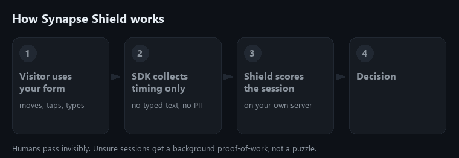
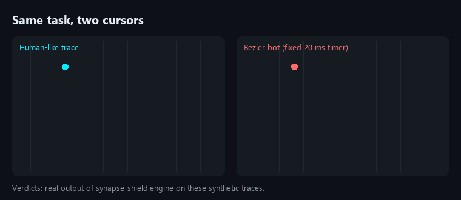

<div align="center">

# 🛡️ Synapse Shield

**Stop bots on your login and signup forms without showing your users a CAPTCHA.**

A self-hosted, open-source alternative to Cloudflare Turnstile. It looks at *how* a visitor moves, taps and types, never at *what* they type.

[](https://pypi.org/project/synapse-shield/)
[](https://github.com/0xStoic-bit/Synapse_Shield/actions)
[](https://python.org)
[](https://opensource.org/licenses/MIT)
[](https://github.com/0xStoic-bit/Synapse_Shield/stargazers)

🌐 English | [简体中文](https://github.com/0xStoic-bit/Synapse_Shield/blob/main/README_ZH.md)



</div>

## Why

- **No puzzles.** Real people just use your form. When the shield is unsure, the browser solves a short proof-of-work in the background instead of showing a picture puzzle.
- **Your server, your data.** Everything runs on your own machine. No third-party service sees your visitors.
- **No typed text leaves the browser.** The SDK sends movement and timing only; every typed character is masked.
- **Drop-in.** One middleware line for FastAPI, Django, Flask, Litestar, Sanic or any ASGI app, plus a small browser SDK (plain JS, React or Vue).

<div align="center">


<sub>Generated from the project's own synthetic traces by <a href="https://github.com/0xStoic-bit/Synapse_Shield/blob/main/scripts/make_readme_gifs.py"><code>scripts/make_readme_gifs.py</code></a>; the verdicts are the engine's real output on those traces.</sub>
</div>

## Install

```bash
pip install "synapse-shield[server]"
```

Start the server with its live dashboard, then open <http://127.0.0.1:8000>:

```bash
synapse-shield run --port 8000
```

Check that everything is set up correctly:

```bash
synapse-shield doctor
```

<details>
<summary><b>Docker</b></summary>

```bash
git clone https://github.com/0xStoic-bit/Synapse_Shield.git
cd Synapse_Shield
docker-compose up -d
```

The API and dashboard are on <http://localhost:8000>.
</details>

<details>
<summary><b>Other install options</b></summary>

| Command | What you get |
| :--- | :--- |
| `pip install synapse-shield` | Scoring engine only (for use inside your own app) |
| `pip install "synapse-shield[server]"` | + the built-in server and dashboard |
| `pip install "synapse-shield[frameworks]"` | + Django, Flask, Sanic and Litestar adapters |
| `pip install "synapse-shield[all]"` | Everything |

Pre-built wheels are published for Linux, macOS and Windows, so no Rust toolchain is needed.
</details>

## Protect a form in 5 minutes

**1. Server** (FastAPI shown, [other frameworks](https://github.com/0xStoic-bit/Synapse_Shield/blob/main/docs/INTEGRATIONS.md)):

```python
from fastapi import FastAPI
from synapse_shield import SynapseShieldMiddleware

app = FastAPI()
app.add_middleware(SynapseShieldMiddleware, protected_paths=["/api/login"])
```

**2. Browser** (plain HTML shown, [React and Vue](https://github.com/0xStoic-bit/Synapse_Shield/blob/main/docs/INTEGRATIONS.md#frontend-sdks)):

```html
<!-- served by `synapse-shield run`; in your own app, serve synapse_shield/static/synapse-sdk.js from the installed package -->
<script src="/static/synapse-sdk.js"></script>
<script>
  SynapseShield.init();
  SynapseShield.protectFetch("/api/login"); // adds the X-Synapse-Token header to these requests

  // your existing code stays the same
  fetch("/api/login", { method: "POST", body: new FormData(loginForm) });
</script>
```

That's it. Requests to `/api/login` without a valid token, or that look automated, are refused before they reach your code.

> When the server is unsure it answers `429 challenge_required` and asks for a background proof-of-work. The React and Vue SDKs solve it automatically (`submitProtected()`); with plain JS, `protectFetch` does not, so handle that response or use one of them ([details](https://github.com/0xStoic-bit/Synapse_Shield/blob/main/docs/INTEGRATIONS.md#proof-of-work-challenges)).

## What your users experience

| Situation | Result |
| :--- | :--- |
| Normal visitor (mouse, touch, trackpad) | Passes, sees nothing |
| Keyboard-only or screen-reader user, very short interaction | Passes after a short background proof-of-work (handled by the React / Vue SDK) |
| Scripted bot, headless browser, replayed request | Blocked |

Want to try it on real traffic first without blocking anyone? Use [shadow mode](https://github.com/0xStoic-bit/Synapse_Shield/blob/main/docs/SHADOW_MODE.md).

## Honest limits

- Bot detection numbers in this project come from synthetic attack generators, not from real bot traffic. Human false-positive numbers come from the public SapiMouse dataset (120 people).
- A determined attacker who records real human sessions and replays each one with small changes can look human. The shield raises the cost (single-use tokens, replay fingerprints, proof-of-work), but it is one layer: keep rate limits and account-level protections such as MFA.

## Documentation

| I want to… | Read |
| :--- | :--- |
| Add it to Django, Flask, Litestar, Sanic, ASGI, React, Vue | [Integrations](https://github.com/0xStoic-bit/Synapse_Shield/blob/main/docs/INTEGRATIONS.md) |
| Tune behaviour, alerts, metrics | [Configuration](https://github.com/0xStoic-bit/Synapse_Shield/blob/main/docs/CONFIGURATION.md) |
| Measure false positives before enforcing | [Shadow mode](https://github.com/0xStoic-bit/Synapse_Shield/blob/main/docs/SHADOW_MODE.md) |
| Know what data is processed and stored | [Privacy notes for operators](https://github.com/0xStoic-bit/Synapse_Shield/blob/main/docs/PRIVACY_OPERATOR_NOTES.md) |
| Understand how detection works | [Architecture](https://github.com/0xStoic-bit/Synapse_Shield/blob/main/docs/ARCHITECTURE.md) |
| See attack test results | [Benchmarks](https://github.com/0xStoic-bit/Synapse_Shield/blob/main/docs/BENCHMARKS.md) |
| Browse every feature by release | [Feature history](https://github.com/0xStoic-bit/Synapse_Shield/blob/main/docs/FEATURES.md) |
| Run the tests or build the Rust core | [Tests](https://github.com/0xStoic-bit/Synapse_Shield/blob/main/tests/README.md) · [Rust core](https://github.com/0xStoic-bit/Synapse_Shield/blob/main/crates/synapse_core_rs/README.md) · [SDK tests](https://github.com/0xStoic-bit/Synapse_Shield/blob/main/sdk-tests/README.md) |

Full index: [`docs/`](https://github.com/0xStoic-bit/Synapse_Shield/blob/main/docs/README.md).

## Support

If Synapse Shield saves you from a CAPTCHA or a bot swarm, a ⭐ helps other developers find it. Issues and pull requests are welcome ([CONTRIBUTING.md](https://github.com/0xStoic-bit/Synapse_Shield/blob/main/CONTRIBUTING.md)), and you can [sponsor the project](https://github.com/sponsors/0xStoic-bit).

Featured on [Mfuns](https://www.mfuns.net/article/123158) (architecture review, in Chinese).

## License

[MIT](https://opensource.org/licenses/MIT). Free for commercial and personal use.
