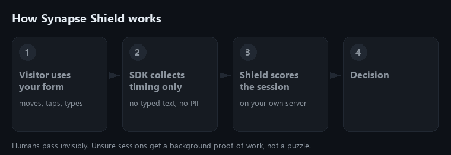
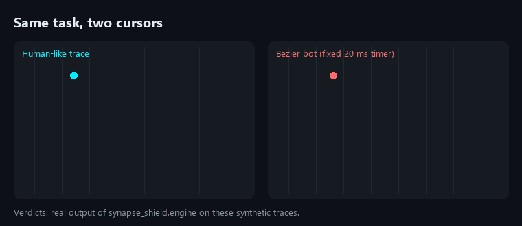

<div align="center">

# 🛡️ Synapse Shield

**无需验证码，即可拦截登录和注册表单上的机器人。**

可自托管的开源 Cloudflare Turnstile 替代方案。它关注访客*如何*移动、点击和输入，而从不读取*输入的内容*。

[](https://pypi.org/project/synapse-shield/)
[](https://github.com/0xStoic-bit/Synapse_Shield/actions)
[](https://python.org)
[](https://opensource.org/licenses/MIT)

🌐 [English](https://github.com/0xStoic-bit/Synapse_Shield/blob/main/README.md) | 简体中文



</div>

## 为什么选择它

- **没有拼图。** 真实用户直接使用表单即可。当系统不确定时，浏览器会在后台完成一次简短的工作量证明（PoW），而不是弹出图片验证。
- **你的服务器，你的数据。** 一切都在你自己的机器上运行，没有第三方服务能看到你的访客。
- **输入的文字不会离开浏览器。** SDK 只发送移动和时间信息，所有输入的字符都会被屏蔽。
- **即插即用。** FastAPI、Django、Flask、Litestar、Sanic 或任意 ASGI 应用只需一行中间件，再加一个轻量的浏览器 SDK（原生 JS、React 或 Vue）。

<div align="center">


<sub>由 <a href="https://github.com/0xStoic-bit/Synapse_Shield/blob/main/scripts/make_readme_gifs.py"><code>scripts/make_readme_gifs.py</code></a> 根据项目自带的合成轨迹生成；判定结果是引擎对这些轨迹的真实输出。</sub>
</div>

## 安装

```bash
pip install "synapse-shield[server]"
```

启动服务器和实时仪表盘，然后打开 <http://127.0.0.1:8000>：

```bash
synapse-shield run --port 8000
```

检查安装是否正确：

```bash
synapse-shield doctor
```

<details>
<summary><b>Docker</b></summary>

```bash
git clone https://github.com/0xStoic-bit/Synapse_Shield.git
cd Synapse_Shield
docker-compose up -d
```

API 和仪表盘位于 <http://localhost:8000>。
</details>

<details>
<summary><b>其他安装方式</b></summary>

| 命令 | 内容 |
| :--- | :--- |
| `pip install synapse-shield` | 仅评分引擎（嵌入你自己的应用） |
| `pip install "synapse-shield[server]"` | + 内置服务器和仪表盘 |
| `pip install "synapse-shield[frameworks]"` | + Django、Flask、Sanic、Litestar 适配器 |
| `pip install "synapse-shield[all]"` | 全部 |

已为 Linux、macOS 和 Windows 发布预编译 wheel，无需安装 Rust 工具链。
</details>

## 5 分钟保护一个表单

**1. 服务器端**（以 FastAPI 为例，[其他框架](https://github.com/0xStoic-bit/Synapse_Shield/blob/main/docs/INTEGRATIONS.md)）：

```python
from fastapi import FastAPI
from synapse_shield import SynapseShieldMiddleware

app = FastAPI()
app.add_middleware(SynapseShieldMiddleware, protected_paths=["/api/login"])
```

**2. 浏览器端**（以原生 HTML 为例，[React 和 Vue](https://github.com/0xStoic-bit/Synapse_Shield/blob/main/docs/INTEGRATIONS.md#frontend-sdks)）：

```html
<!-- 由 `synapse-shield run` 提供；在你自己的应用中，请从已安装的包中提供 synapse_shield/static/synapse-sdk.js -->
<script src="/static/synapse-sdk.js"></script>
<script>
  SynapseShield.init();
  SynapseShield.protectFetch("/api/login"); // 为这些请求自动添加 X-Synapse-Token 请求头

  // 你现有的代码保持不变
  fetch("/api/login", { method: "POST", body: new FormData(loginForm) });
</script>
```

完成。没有有效令牌或看起来像自动化的 `/api/login` 请求，会在到达你的代码之前被拒绝。

> 当服务器不确定时，会返回 `429 challenge_required` 并要求后台工作量证明。React 和 Vue SDK 会自动完成（`submitProtected()`）；原生 JS 的 `protectFetch` 不会自动完成，请自行处理该响应或改用它们（[详情](https://github.com/0xStoic-bit/Synapse_Shield/blob/main/docs/INTEGRATIONS.md#proof-of-work-challenges)）。

## 用户的实际体验

| 情况 | 结果 |
| :--- | :--- |
| 普通访客（鼠标、触屏、触控板） | 直接通过，无感知 |
| 纯键盘或读屏软件用户、交互非常短 | 后台完成一次简短的工作量证明后通过（由 React / Vue SDK 处理） |
| 脚本机器人、无头浏览器、重放请求 | 被拦截 |

想先在真实流量上试运行而不拦截任何人？请使用 [影子模式](https://github.com/0xStoic-bit/Synapse_Shield/blob/main/docs/SHADOW_MODE.md)。

## 诚实的局限

- 本项目的机器人检测数据来自合成攻击生成器，而非真实机器人流量；真人误报数据来自公开的 SapiMouse 数据集（120 人）。
- 坚定的攻击者若录制真实用户会话并逐条略加修改后重放，可能看起来像真人。本系统会提高其成本（一次性令牌、重放指纹、工作量证明），但它只是一层防护：请保留限流以及 MFA 等账户级保护。

## 文档（英文）

| 我想要… | 阅读 |
| :--- | :--- |
| 接入 Django、Flask、Litestar、Sanic、ASGI、React、Vue | [Integrations](https://github.com/0xStoic-bit/Synapse_Shield/blob/main/docs/INTEGRATIONS.md) |
| 调整行为、告警、指标 | [Configuration](https://github.com/0xStoic-bit/Synapse_Shield/blob/main/docs/CONFIGURATION.md) |
| 正式拦截前先测量误报 | [Shadow mode](https://github.com/0xStoic-bit/Synapse_Shield/blob/main/docs/SHADOW_MODE.md) |
| 了解处理和存储了哪些数据 | [Privacy notes for operators](https://github.com/0xStoic-bit/Synapse_Shield/blob/main/docs/PRIVACY_OPERATOR_NOTES.md) |
| 了解检测原理 | [Architecture](https://github.com/0xStoic-bit/Synapse_Shield/blob/main/docs/ARCHITECTURE.md) |
| 查看攻击测试结果 | [Benchmarks](https://github.com/0xStoic-bit/Synapse_Shield/blob/main/docs/BENCHMARKS.md) |
| 按版本浏览全部功能 | [Feature history](https://github.com/0xStoic-bit/Synapse_Shield/blob/main/docs/FEATURES.md) |

完整索引：[`docs/`](https://github.com/0xStoic-bit/Synapse_Shield/blob/main/docs/README.md)。

## 支持

如果 Synapse Shield 帮你摆脱了验证码或机器人攻击，点一个 ⭐ 能帮助更多开发者发现它。欢迎提交 Issue 和 Pull Request，也可以 [赞助本项目](https://github.com/sponsors/0xStoic-bit)。

相关报道：[Mfuns：Synapse Shield 架构深度解析](https://www.mfuns.net/article/123158)。

## 许可证

[MIT](https://opensource.org/licenses/MIT)。可免费用于商业和个人用途。
